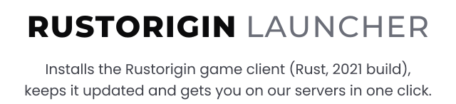

  <picture>
    <source media="(prefers-color-scheme: dark)" srcset="docs/readme/banner-dark.svg">
    
  </picture>

  <a href="https://github.com/RUSTORIGIN/launcher/releases/latest"><picture><source media="(prefers-color-scheme: dark)" srcset="docs/readme/badge-release-dark.svg"></picture></a>
  <a href="https://github.com/RUSTORIGIN/launcher/releases"><picture><source media="(prefers-color-scheme: dark)" srcset="docs/readme/badge-downloads-dark.svg"></picture></a>
  <a href="LICENSE"><picture><source media="(prefers-color-scheme: dark)" srcset="docs/readme/badge-license-dark.svg"></picture></a>

## Download

Grab `RustoriginLauncher-Setup.exe` (installer) or `RustoriginLauncher.exe` (portable, just run it) from the [latest release](https://github.com/RUSTORIGIN/launcher/releases/latest). Windows 10/11 only, no .NET download needed.

VirusTotal, v1.1.2:

- `RustoriginLauncher-Setup.exe`: [1/70 engines flag it](https://www.virustotal.com/gui/file/285d15a8d6835a73f6ae34ab1ae6db23e1c76f8b7b4bb96623b22d0c58305202) (SecureAge), scanned October 2026.
- `RustoriginLauncher.exe`: [no engine flags it](https://www.virustotal.com/gui/file/3770305fe0804a38cb1c1f50bd0210e945078ed21d139369d6258254a25343da), scanned October 2026.
- `RustoriginLauncher-Setup.msi`: [no engine flags it](https://www.virustotal.com/gui/file/c36af52897bcec88503cfd5b7aa5f9da0c23fa2465f03d9d81949aac76dddcb5), scanned October 2026.

## How to use

https://github.com/user-attachments/assets/77bba586-7bcd-4218-99cc-b57cc5724826

1. Run the setup, or the portable exe.
2. Click **INSTALL** and pick a folder. The game goes into a `Rustorigin` subfolder (suggested: `C:\Rustorigin`). Closing it mid-download is fine, it resumes next time.
3. Hit **PLAY**, or click a server card to join that server. Cards show live player counts.

## What the launcher does

  <picture>
    <source media="(prefers-color-scheme: dark)" srcset="docs/readme/flow-dark.svg">
    
  </picture>

This is the full list.

- Downloads the game (`RustClient.zip`, or a smaller update pack) over HTTPS and checks its SHA-256 before unpacking. A file that doesn't match is deleted, never installed.
- Installs into the folder you pick and locks it so only your Windows account, SYSTEM and Administrators can write to it. Links and files owned by other accounts inside it get deleted.
- Copies itself into the install folder and puts a shortcut on your desktop.
- Keeps its own files in `%LOCALAPPDATA%\Rustorigin\`: the download, `launcher.log`, your settings (`prefs.cfg`) and its images and fonts.
- Asks each server for its player count once a minute, the same Steam query the in-game server list uses.
- Runs `RustClient.exe` from the install folder when you hit PLAY.
- Checks GitHub Releases on every start for a newer launcher, and installs it only if its SHA-256 matches the release's `SHA256SUMS.txt`.
- Shows "In the launcher" / "In game" on your Discord profile while Discord is open. You can turn this off in settings (gear, top right).
- Anti-cheat session: not switched on yet. Once it is, the launcher tells you the first time you play, and while you play it sends your SteamID, the launcher version, whether the game is running, a one-way hash of your PC's Windows install id, and a short label when a known cheat tool is running or a game file was modified. It will also read one code the server sends to the game from the game's own log. No process lists, no files, no file contents. Staff use the PC hash to spot alt accounts and ban evasion. Closing the launcher mid-game will then send it to the tray, because the server can kick players without a session. Details: [docs/CLIENT_ANTICHEAT.md](docs/CLIENT_ANTICHEAT.md).

It doesn't need admin rights (except the one-time folder fix below), and it doesn't touch Defender, SmartScreen, antivirus exclusions, services or browser settings.

## Common problems

Windows says "Windows protected your PC".

 

The exe isn't code-signed, so SmartScreen warns on first run. Click *More info → Run anyway*.

My antivirus blocks the .exe.

 

Use `RustoriginLauncher-Setup.msi` from the same release. It installs per-user and doesn't need admin. Hashes for every file are in `SHA256SUMS.txt`.

The button says UPDATE instead of PLAY.

 

The server moved to a newer game build. Click it: you only download what changed (about 1.5 GB instead of 11 GB), every file gets checked, and if that can't be used it falls back to the full download.

It won't install or play from my folder.

 

The launcher refuses a folder other accounts could change, and its message says what to do. On a new install, click **INSTALL** again and pick another folder. If the game is already in that folder, accept the one-time fix when it asks for admin permission, or move the game to a normal folder on an NTFS drive. If it says files are open in another program, close the game and try again.

Still stuck? Post your `%LOCALAPPDATA%\Rustorigin\launcher.log` in our [Discord](https://discord.gg/rustorigin).

## License

[MIT](LICENSE). Bundled fonts (Montserrat and Poppins) are under the SIL Open Font License, see [`assets/fonts/`](assets/fonts).
